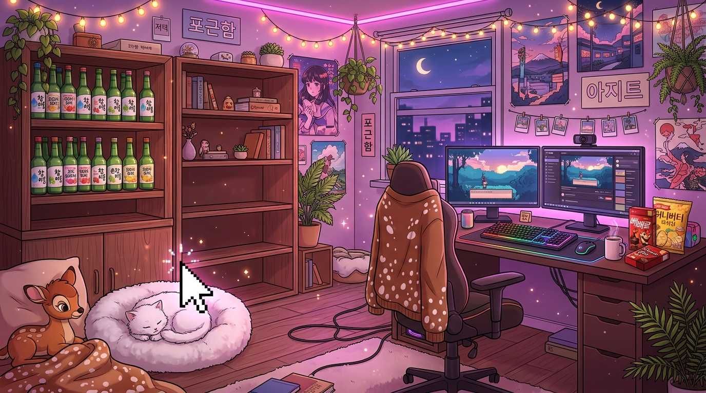

# 🌸 Cozy Anime Bedroom - Canlı & İnteraktif Deneyim

[](https://sytali0.github.io/cozy-anime-room/)
[](LICENSE)

> Sıcak lo-fi akşam aydınlatması, Kore sokak esintileri, mırıldanan bir kedi ve tarayıcıda canlı sentezlenen lo-fi ambiyans sesleriyle interaktif 2D anime yatak odası.



## 🌐 Canlı Demo
Uygulamayı hemen tarayıcınızda deneyin:  
👉 **[https://sytali0.github.io/cozy-anime-room/](https://sytali0.github.io/cozy-anime-room/)**

---

## ✨ Öne Çıkan Özellikler

### 🐱 1. Pamuk (İnteraktif Kedi Köşesi)
* Sol alttaki beyaz pofuduk kedi yatağına tıklayarak kediyi uyandırabilir ve sevebilirsiniz.
* Gerçekçi Web Audio miyavlama ve mırlama sesleri.
* Tıkladıkça yükselen sevgi barı ve uçuşan kalp/yıldız animasyonları.

### 📦 2. Boş Ahşap Rafları Doldurma (Özelleştirilebilir Vitrin)
* Sol duvardaki boş ahşap raflara dilediğiniz dekorasyon ürünlerini ekleyin:
  * 🍾 *Aromalı Kore Sojuları (Şeftali, Elma, Jinro)*
  * 🦌 *Mini Bambi biblosu*
  * ✨ *Anya Forger / Anime figürleri*
  * 🌿 *Mini sukulent ve saksı bitkileri*
  * 📖 *Lo-Fi manga koleksiyonları*
  * 📸 *Pastel polaroid kamera*

### 🖥️ 3. Çift Monitör & Çalışma Masası
* Ekranlara tıklayarak monitör modunu değiştirin:
  * 🎧 *Lo-Fi Chill Girl Canlı Yayını*
  * 🎮 *Retro Pixel RPG Oyunu*
  * 💻 *Cyberpunk Matrix Kod Ekranı*
  * 🔥 *4K Rahatlatıcı Şömine*
* Masadaki Pepero kutusuna tıklayarak çıtır sesiyle atıştırmalık yiyin.
* RGB mekanik klavyeye dokunarak renk dalgası animasyonunu tetikleyin.

### 🎧 4. Lo-Fi Ambiyans Ses Mikseri (Web Audio API)
Harici hiçbir ses dosyasına ihtiyaç duymadan, doğrudan tarayıcının ses motoruyla anlık sentezlenen 4 bağımsız ses kanalı:
* 🎹 **Lo-Fi Piyano Akorları:** Analog Rhodes tonunda 7'li caz akor dizisi (Cmaj9 - Am9 - Dm9 - G7sus4).
* 🌧️ **Cama Vuran Yağmur:** Filtrelenmiş pembe gürültü yağmur simülatörü.
* 🔥 **Sıcak Şömine:** Çıtırdayan odun sesleri.
* 🌙 **Gece Esintisi:** Gece rüzgarı ve sakinleştirici cırcır böcekleri.

### 💡 5. Oda Işıklandırması & Atmosfer Modları
* **Cozy Akşam:** Pembe ve mor neon parıltılar, sıcak sarı peri ışıkları.
* **Gece Yarısı:** Derin gece mavisi, pencereden süzülen ay ışığı.
* **Yağmurlu Gün:** Loş mavi tonlar, pencereye vuran yağmur efekti.
* **Gün Batımı:** Şehrin kızıla boyandığı altın saat parıltısı.
* ⛶ **Tam Ekran (Sinematik Duvar Kağıdı):** Tek tıkla tam ekran yapıp monitörünüzde canlı duvar kağıdı olarak kullanın.

---

## 🛠️ Teknolojiler
* **HTML5 Canvas:** Havada süzülen toz ve ışıltı parçacıkları.
* **Tailwind CSS:** Modern cam (glassmorphism) arayüz tasarımı.
* **Web Audio API:** Sıfır harici bağımlılıkla çalışan saf JavaScript ses sentezleyici.

---

## 🚀 Yerel Olarak Çalıştırma
Projeyi bilgisayarınızda çalıştırmak için herhangi bir sunucuya gerek yoktur:
```bash
git clone https://github.com/sytali0/cozy-anime-room.git
cd cozy-anime-room
# index.html dosyasını herhangi bir tarayıcıda açmanız yeterlidir!
```

---

*Made with 💖 for cozy lo-fi anime aesthetic lovers.*
